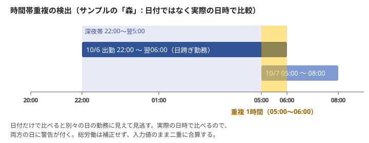
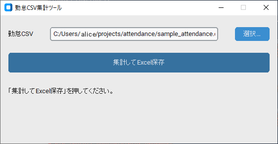
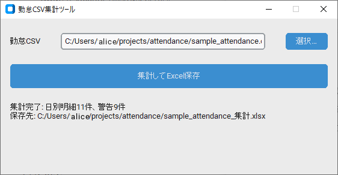
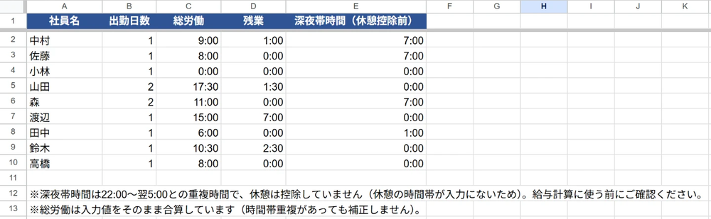
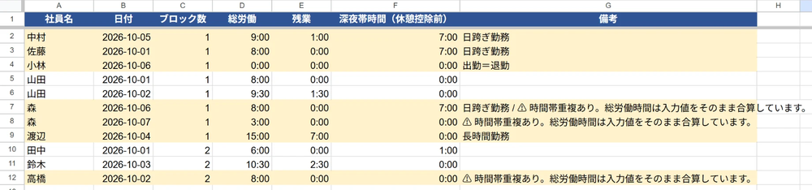
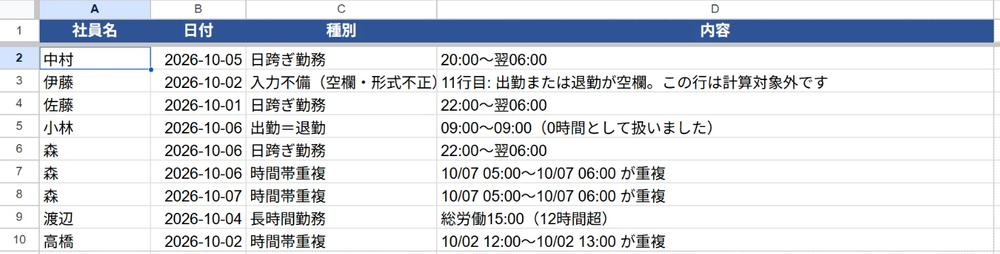

# 勤怠CSV自動集計ツール

勤怠CSVから、人別・日別の労働時間（総労働・残業・深夜帯）を集計し、入力ミスや異常な勤務を警告付きでExcelに出力する Python ツールです。

> **個人制作（想定案件）です。** 清掃・現場系の小規模事業者を想定して、仕様の決定から実装・検証までを個人で行いました（AIコーディングアシスタントを使用。[開発メモ](#開発メモ)を参照）。実際の顧客データは使っておらず、サンプルはすべてダミーです。運用実績はありません。

「給与計算」ではなく **「時間の集計と警告」まで**を範囲としています。金額の計算は行いません。

## このツールで見てほしい点

- **曖昧な業務ルールを決めて、理由と一緒に文書化した**（日跨ぎ・時間帯重複・深夜帯と休憩の扱いなど → [集計ルール](#集計ルール判断した点と理由)）
- **手計算の正解を期待値にした検算テスト**。期待値は実装に合わせて変えない運用です（→ [テスト](#テスト)）
- **不正な入力を黙って通さない**。警告や明示エラーにして、直し方が分かるメッセージを出します（→ [入力の検証](#入力の検証)）
- 集計ロジック・Excel出力・GUIを分離し、GUIは `process()` と `write_excel()` を呼ぶだけにしています



## デモ

同梱のダミーデータ（`sample_attendance.csv`）を集計した画面です。

### GUI

<table>
  <tr>
    <td align="center"><br>CSVを選んで「集計してExcel保存」を押す</td>
    <td align="center"><br>完了後は件数と保存先を表示</td>
  </tr>
</table>

> 画像内のパスは、公開用にユーザー名を別の名前（alice）へ差し替えています。

### 出力ファイル

出力した `.xlsx` をGoogleスプレッドシートで開いた画面です。

**人別集計** — 社員ごとの出勤日数・総労働・残業・深夜帯時間。表の下に、休憩を控除していないことと、時間帯重複を補正していないことの注記を出します。



**日別明細** — 警告がある日は黄色で表示し、備考に内容を出します。「森」は日跨ぎ勤務と時間帯重複が、10/6 と 10/7 の両方の日に付いています。「渡辺」は総労働15:00で長時間勤務です。



**警告一覧** — 警告の種類と詳細。「伊藤」は退勤が空欄のため、CSVの11行目として指摘し、計算対象外にしています。



## セットアップ

Python 3.13.9（Windows 10）で動作確認しています。他の版は未確認です。

```powershell
python -m venv .venv
.venv\Scripts\activate
pip install -r requirements.txt
```

集計ロジックと単体テストの大半は標準ライブラリだけで動きます。`openpyxl` は Excel 出力、`customtkinter` は GUI でのみ使います。

## 使い方

### コマンドライン
```powershell
python attendance.py sample_attendance.csv 結果.xlsx --config config.json
```

### GUI
```powershell
python gui.py
```
「選択…」でCSVを選び →「集計してExcel保存」→ 保存先を指定します。設定やCSVに不備があるときは、原因と直し方を示すメッセージを表示します。`config.json` が `gui.py` と同じフォルダにあれば自動で読み込みます。

`sample_attendance.csv` を集計した結果の例が [勤怠集計_サンプル出力.xlsx](勤怠集計_サンプル出力.xlsx) です。

## 入力CSV

UTF-8（BOM付き可）で、**1行が1勤務ブロック**です。

| 列 | 必須 | 例 | 備考 |
|---|---|---|---|
| 社員名 | ○ | 山田 | 空欄の行は計算対象外（警告） |
| 日付 | ○ | 2026-10-01 | `2026/10/01` も可 |
| 出勤 | ○ | 09:00 | `HH:MM` |
| 退勤 | ○ | 18:00 | 出勤より前なら翌日扱い（日跨ぎ） |
| 休憩(分) | ○ | 60 | 整数。空欄は0分 |
| 現場名 | | 現場A | 集計には使わない |

- 中抜けや掛け持ちは、同じ日に複数行で入力します。
- 列の順序は問いません。
- **Excelで「CSV（コンマ区切り）」として保存するとShift_JIS（cp932）になり、読み込めません。** 「CSV UTF-8（コンマ区切り）」で保存してください（cp932の自動判別は未対応です）。

## 出力Excel

| シート | 内容 |
|---|---|
| 人別集計 | 社員ごとの出勤日数・総労働・残業・深夜帯時間 |
| 日別明細 | 社員×日付の明細。警告がある行は黄色で表示し、備考に内容を出す |
| 警告一覧 | 警告の種類と詳細（行番号付き） |

## 集計ルール（判断した点と理由）

勤怠の仕様には曖昧な点が多いため、次のように決めています（初期値。一部は `config.json` で変更可）。

| ルール | 決めたこと | 理由 |
|---|---|---|
| 総労働 | 退勤 − 出勤 − 休憩。同じ社員・同じ日のブロックを合算 | 中抜け・掛け持ちに対応するため |
| 日跨ぎ | 退勤が出勤より前なら翌日扱い。勤務は**出勤した日**に紐づける | 日をまたぐ勤務を1つの勤務として扱うため |
| 残業 | 1日の総労働が8時間を超えた分 | 週次・割増は扱わない（下の[制約](#制約未対応のこと)） |
| 深夜帯時間 | 22:00〜翌5:00との重複時間。**休憩は控除しない**。表記は「深夜帯時間（休憩控除前）」 | 入力に休憩の時間帯がなく、深夜帯のどこで休んだか分からないため |
| 時間帯の重複 | **補正せず二重に合算し、警告する** | 重複が入力ミスか実態かをツールは判断できないため、判断を利用者に残す |
| 重複判定 | **日付ではなく実際の日時**で比べる | 前日からの日跨ぎ勤務との重なりを拾うため（上の図） |
| 出勤＝退勤 | 0時間として扱い、警告する | 打刻漏れの可能性が高いため |

### 警告の種類

入力不備（空欄・形式不正）／ 出勤＝退勤 ／ 時間帯重複 ／ 日跨ぎ勤務 ／ 長時間勤務（初期値: 総労働12時間超）

### 設定（config.json）

| キー | 初期値 | 意味 |
|---|---|---|
| `night_start` / `night_end` | `"22:00"` / `"05:00"` | 深夜帯の開始・終了（`HH:MM`） |
| `daily_limit_hours` | `8` | これを超えた分を残業とする |
| `long_day_hours` | `12` | これを超えたら「長時間勤務」の警告 |

`daily_limit_hours` と `long_day_hours` は**独立した閾値**で、大小関係は問いません。

## 入力の検証

不正な入力が**警告なしで誤った集計結果になる**ことを避けるため、次の検証を入れています。いずれも勤怠の計算ロジックは変えず、不備を明示するだけです。

| 対象 | 動作 |
|---|---|
| CSVの必須列が欠けている（例: `休憩(分)` を `休憩` と書いた） | 不足している列名と見つかった列名を示してエラー。検証がないと休憩が0分扱いになり、総労働が1時間多く出る |
| `社員名` が空欄の行 | 行番号付きの警告にして計算対象外（氏名なしの社員として集計しない） |
| 日付・時刻・休憩の空欄や形式不正 | 行番号付きの警告にして、その行だけ計算対象外 |
| `config.json` の未知のキー（打ち間違い） | エラー。`_` で始まるキーはメモ用として無視 |
| `config.json` の不正値 | エラー。時刻は `HH:MM`、`night_start` と `night_end` は別の時刻、時間数は0以上の有限の数値 |

合理的な設定は禁止しません（例: 日をまたがない深夜帯、残業なし運用の24時間超、0時間）。

## テスト

```powershell
python -m unittest -v
```

```
Ran 40 tests in 0.4s

OK
```

| ファイル | 件数 | 内容 |
|---|---|---|
| `test_attendance.py` | 8 | 集計の検算。サンプルCSVの11件の（社員, 日付）について、総労働・残業・深夜帯・警告を**手計算した正解**と照合。深夜帯の境界値（22:00ちょうど・5:00ちょうど・日付またぎ）や、前日からの日跨ぎ勤務との重複検出を含む |
| `test_validation.py` | 26 | 設定ファイルの検証、CSVヘッダーの検証、氏名なしの行。「弾くべきもの」と「弾いてはいけないもの」の両方を確認 |
| `test_output.py` | 6 | Excel出力（シート名・見出し・時間の書式・警告行の色）とCLI |

- 期待値は手計算の正解で、**コードに合わせて変えません**。`test_attendance.py` の期待値と `sample_attendance.csv` は、入力検証を追加した各コミットでも変更していません（`git log -p` で確認できます）。
- 入力検証は、先に失敗するテストを書いてから実装しました。
- GUIの自動テストはありません。起動と、エラー表示までの経路を手元で確認した範囲です。

## 制約（未対応のこと）

- 残業は「1日8時間超」のみです。週40時間・法定休日・割増率は扱いません。給与の金額計算もしません。
- Shift_JIS（cp932）のCSVは読み込めません。UTF-8で保存してください。
- コマンドラインでは、設定やCSVの不備はエラーメッセージ付きの例外として表示されます（GUIでは整形して表示）。
- 数千行を超える大量データでの性能は未検証です（時間帯重複の判定は一人あたり最悪 O(n²) です）。
- 勤怠管理システムではありません（打刻、承認フロー、法令チェックなどは範囲外）。
- exe化は手順の整理のみで、**実際のビルドと別PCでの動作確認は未実施**です。

## exe化の手順（PyInstaller・未検証）

> 以下は手順の整理です。実際にビルドして別PCで動かす確認は行っていません。

```powershell
pip install pyinstaller
pyinstaller --noconsole --onedir --name 勤怠集計 --collect-data customtkinter gui.py
```

1. `dist/勤怠集計/` ができます。`config.json` を `勤怠集計.exe` の隣にコピーします。
2. 配布は `dist/勤怠集計/` フォルダごとZIPにします。
3. 配布前に、Pythonの入っていない別PCで、起動からExcel保存まで確認します。
4. `--collect-data customtkinter` が必要です（テーマ等のファイルが同梱されず起動時に落ちるのを防ぐため）。
5. 起動しない場合は `--noconsole` を外してビルドし、コンソールのエラーを確認します。

### ウイルス対策ソフトの誤検知について

PyInstaller製のexeは、悪意がなくても誤検知されることがあります（特に `--onefile`）。

- `--onefile` ではなく `--onedir` を使う（起動時に自己展開しないため誤検知されにくい）
- PyInstallerは最新版を使い、ビルドはクリーンなPCで行う
- UPX圧縮は使わない（`--noupx`）
- 配布前に [VirusTotal](https://www.virustotal.com/) 等で確認する（exe本体のみ。顧客データは含めない）
- 未署名のexeのため、Windows SmartScreenが警告を出す場合がある。受け取る側には「『詳細情報』→『実行』で起動できる」と伝える
- 検知された場合は、フォルダを除外設定に追加してもらうか、`python gui.py` で動かす方法を案内する
- コード署名証明書による署名は費用がかかるため未対応

## 開発メモ

- 開発ルールは [CLAUDE.md](CLAUDE.md) に書いています（変えないルール、テストの運用など）。
- 実装・テストの作成に、AIコーディングアシスタント（Claude Code）を使用しています。コミットの `Co-Authored-By` に記録しています。

## ライセンス

[MIT](LICENSE)
